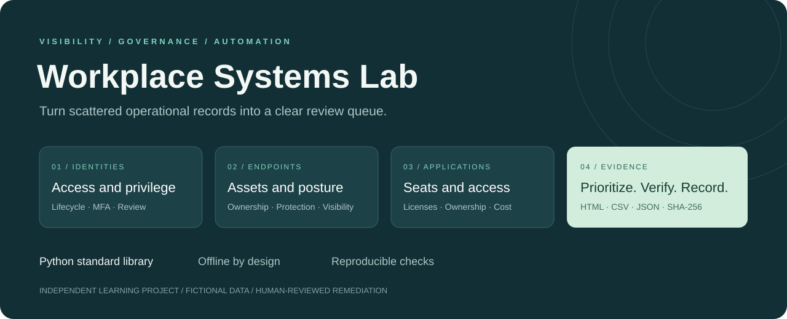

# Workplace Systems Lab



A practical systems operations lab for reviewing identities, endpoint posture, application access, asset lifecycles and operational evidence. Includes automated checks, prioritized findings and documented workflows.

**Independent learning project. All employee records and incidents are fictional.** No live Google Workspace, identity provider, VPN or MDM is connected. This project does not establish SOC 2, HIPAA or PCI DSS compliance.

## Run in two commands

Install Python 3.10 or newer. No packages, paid tools or administrator rights required.

```sh
python lab.py
python -m unittest discover -s tests -v
```

Open [the sample report](evidence/report.html) in a browser. GitHub displays its source; download or clone the repository to view the rendered report.

```sh
python lab.py --as-of 2026-10-14 --data data --out evidence
```

The sample date is fixed for reproducibility. Pass your actual review date when working with a different dataset.

## What it demonstrates

| Operations area | Working artifact |
| --- | --- |
| Identity and access reviews | Flags departed users, missing MFA and privileged access requiring review |
| Laptop inventory | Windows, macOS and Linux sample assets; ownership, encryption, antivirus and MDM checks |
| SaaS administration | Flags assigned seats belonging to departed or unknown users |
| Request handling | Tracks overdue tickets; includes triage and employee communication examples |
| Audit support | Timestamped JSON, CSV, readable HTML and SHA-256 evidence manifest |
| Documentation | Onboarding, offboarding, VPN and security incident runbooks |
| Automation | Python CLI, automated tests and GitHub Actions workflow |

For the bundled dataset: **6 users, 6 assets, 4 tickets, 13 findings and $39/month in potential reclaimable seats**. These are simulated results, not real savings. Prices are invented examples. A hash helps check file integrity; it does not prove the source evidence is correct.

## Architecture

```text
CSV exports -> Python review rules -> prioritized findings
                                  -> HTML report
                                  -> CSV / JSON evidence -> SHA-256 manifest
IT analyst -> validate -> obtain approval -> remediate in actual system -> re-export -> review
```

The analyzer reads inputs and writes reports only. It does not change employee accounts or device settings. Seat candidates require human review of contracts, retention and ownership transfer. Non-IT admin access is a review trigger, not automatically an error. Tickets use a simplified date-based due policy, not a business-hours SLA engine.

## Explore the repository

- [Runbooks and completed fictional tickets](docs/runbooks.md)
- [Hands-on practice and interview demonstration](docs/practice.md)
- [Resume wording and skills boundaries](docs/resume.md)
- [Review checklist and evidence mapping](docs/evidence-guide.md)
- [Machine-readable findings](evidence/report.json)

## Data and security boundaries

Use fictional data in this public repository. Never commit actual employee records, serial numbers, recovery keys, API tokens or exported logs. `private-data/` and `.env` are ignored as a convenience, not a guarantee against leaks. The report deliberately includes only sample identities. HTML values are escaped and CSV formula prefixes are neutralized. Input CSVs must use the supplied headers and valid ISO dates; malformed or missing fields cause an error. This is a small lab, without production schema enforcement, duplicate identity reconciliation or live API integrations.

## Reference documentation

- [Google Workspace: identify and secure compromised accounts](https://support.google.com/a/answer/2984349)
- [Microsoft Intune: device compliance overview](https://learn.microsoft.com/en-us/intune/device-security/compliance/overview)

These explain real administration concepts. The local rules do not implement those products.
